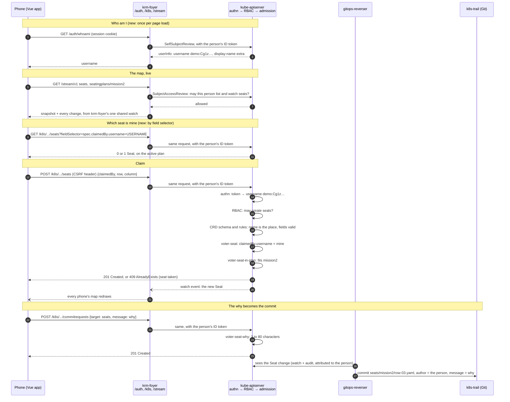

# Design: whose seat it is, by Kubernetes identity

Status: built, 2026-10-29. The browser suite's seats.spec.js runs it end to end,
including the GitHub operator's claim and a participant refused another's seat.

## Problem

A Seat says whose it is with `spec.displayName`, and admission holds the
`voter.configbutler.ai/submitter` label to that same name. That only works
because Room Pass folds every participant's name into a valid label value
(`Simon Koudijs` becomes `Simon-Koudijs`). A GitHub or LinkedIn sign-in is not
folded: on 2026-10-29 the operator's `Simon Koudijs` turned the Seat tab into a
400, because a label selector cannot carry a space.

A display name is also not an identity. Room Pass keeps names unique within one
room, but two GitHub users can both be "John Smith". What RBAC, audit and Git
attribution key on is the **username the API server makes of the token**:

| Connector | Username |
| --- | --- |
| room-pass | `demo:<Dex sub>` (opaque, e.g. `demo:Cg1zaW1vbi1rb3VkaWpz…`) |
| github | `github:<email>` |
| linkedin | `linkedin:<email>` |

That username cannot be a label value (`:` and `@` are not allowed, and a
`demo:` one can run past 63 characters), but it does not need to be one.

## How a claim travels

Voter's Go backend is not involved: it serves the page and `/config.json`, and
nothing else about seats. Every read and write goes from the phone through
krm-foyer to the API server, **as the person**. krm-foyer holds the session
cookie and puts the person's own ID token on each `/k8s` request, so the API
server authenticates, authorizes and admits them, not a service account. Live
updates come over `/stream/v1`, from one watch krm-foyer holds for the whole
room; each phone is checked with SubjectAccessReviews before it is served and
every 30 seconds after.

The steps marked *new* are what this design added.



## Design

A Seat carries who claimed it as an object:

```yaml
metadata:
  name: mission2-3-7
  labels:
    voter.configbutler.ai/seatingplan: mission2
    voter.configbutler.ai/row: "03"
    voter.configbutler.ai/column: "07"
spec:
  seatingPlanRef: { name: mission2 }
  row: 3
  column: 7
  claimedBy:
    displayName: Simon Koudijs                # the chosen name, or the GitHub one
    username: github:simonkoudijs@gmail.com   # the full Kubernetes username
  color: "#2ec4b6"
  emoji: "🦊"
```

- **`claimedBy.username`** is the identity. Admission holds it equal to
  `request.userInfo.username`, exactly. No folding, for every connector, now
  and later.
- **`claimedBy.displayName`** is for people: the map and `kubectl get seats`.
  Any string. For a Room Pass participant admission still holds it to the name
  in their token.
- `spec.displayName` and the `submitter` label go away. Git filing does not use
  them: the seats GitTarget files by the plan and row labels, which stay.

### Finding my seat

The CRD declares `spec.claimedBy.username` a selectable field:

```yaml
selectableFields:
  - jsonPath: .spec.claimedBy.username
```

so the API server answers "which seat is mine?" itself, with
`fieldSelector=spec.claimedBy.username=<username>`, and the page keeps the one
on the active plan. The same works from a terminal:
`kubectl get seats --field-selector spec.claimedBy.username=demo:Cg1z…`.

The value is a field the API server has already checked on every write, so the
answer can be trusted as it is. A field selector escapes only `\`, `,` and `=`;
the page escapes those, and a username normally has none.

`selectableFields` is stable since Kubernetes 1.32. The cluster runs 1.37; the
fixture's k3s 1.31 has it in beta, on by default.

### Where the browser gets the username

From krm-foyer's `/auth/whoami`, which the API server answers with a
SelfSubjectReview using the person's own token. It is asked once per page load
and cached.

### What admission holds

`voter-seat`, for Room Pass participants (`demo:`), as today:

- CREATE: `claimedBy.username == request.userInfo.username`;
  `claimedBy.displayName ==` the token's display-name extra; the plan, row and
  column labels as today.
- UPDATE: `oldObject.spec.claimedBy.username == request.userInfo.username`
  (only your own seat), and still no metadata changes.

The CRD makes `claimedBy` required and immutable, and bounds `username` and
`displayName` in length.

### Nobody changes someone else's seat

RBAC cannot say "only your own object": a participant's Role
(`participant-rbac.yaml`) grants `get, list, watch, create, patch` on **all**
seats in the namespace, and no `delete` or `update`. What narrows that to your
own seat is admission and the CRD, which every write passes, whatever tool
sends it (the page, `kubectl`, `curl` with a token):

| Attempt by a participant | What stops it | Answer |
| --- | --- | --- |
| Recolour someone else's seat | `voter-seat` UPDATE: `oldObject.spec.claimedBy.username` must be the requester's | 403 "This is someone else's seat." |
| Take over a seat by rewriting `claimedBy` | CRD: `claimedBy` is immutable (`self == oldSelf`); and the rule above, since the *old* owner is checked | 422 / 403 |
| Move a seat, or change its plan | CRD: `row`, `column`, `seatingPlanRef` immutable | 422 |
| Relabel a seat | `voter-seat` UPDATE: labels, annotations, finalizers and ownerReferences unchanged | 403 |
| Claim a seat that is taken | The name is the place, so it is a second create of one name | 409 AlreadyExists |
| Claim a seat in someone else's name | `voter-seat` CREATE: `claimedBy.username` must be the requester's | 403 |
| Delete a seat | RBAC: no `delete` | 403 |
| Write as someone else | krm-foyer sends only the session's own token, and the API server derives the username from it | — |

Patch, update and server-side apply are all an UPDATE to admission, so there
is no verb that skips the rule. The rules match `demo:` users only: an operator
signed in with GitHub is cluster-admin and may fix any seat.

## Costs and open questions

1. **Email in view.** A GitHub or LinkedIn username *is* an email, and every
   phone streams every Seat and every Seat is mirrored to `k8s-trail`. Today
   only Room Pass participants and the operator take seats, so it is accepted
   for now; revisit before LinkedIn participants take seats.
2. **Operators.** The policy only matches `demo:` users, so an operator's
   claim is unchecked, as today. With the username as the key, the CREATE rule
   could hold for every person; the UPDATE rule should not, or the operator
   could no longer fix someone's seat.
3. **Load.** One extra SelfSubjectReview per page load per phone. Small next
   to the stream rechecks.

## Rollout

- CRD (`claimedBy`, `selectableFields`, printer column `.spec.claimedBy.displayName`)
  and `voter-seat` policy in `voter/config/`, copied into
  `external/k8s/.../voter-demo/` (pull first).
- Frontend: `seats.ts` (`buildSeat`, `findMySeat`), a cached username in
  `whoami.ts`, the two seat screens, `seatOnboarding.ts`, unit tests and
  `test/browser/seats.spec.js`.
- Existing Seats have no `claimedBy`, and a required field refuses their next
  update. Clear them before the change reaches production:
  `kubectl -n voter delete seats --all`, the documented recovery in entry 9.
- Docs: ARCHITECTURE.md's Seats section and admission list, and entries 8
  and 9 of deliberate-simplifications.md.

Ballots carry the same display-name-as-key design. They work today because
only Room Pass participants vote, and are out of scope here.
